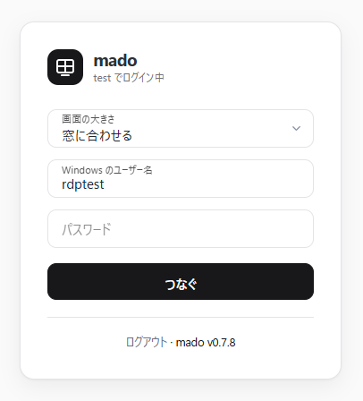
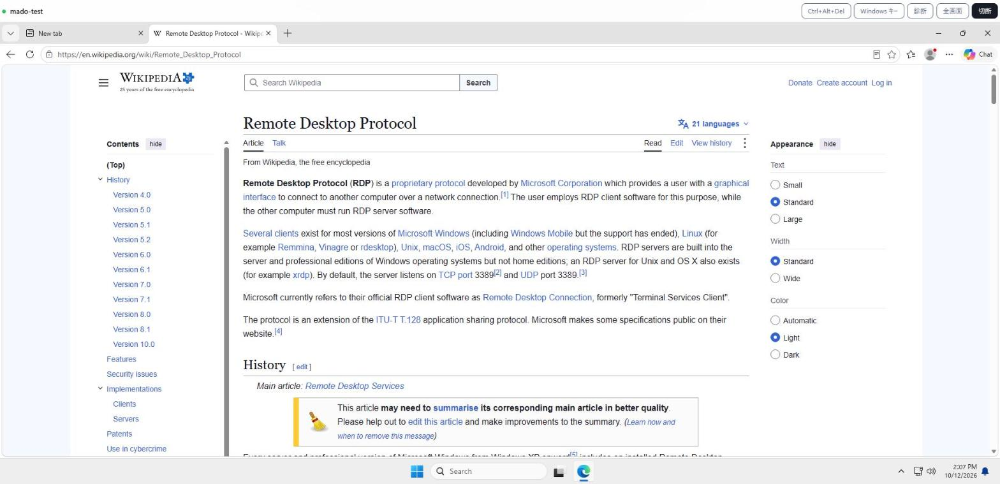

# mado

OIDC でログインして、ブラウザから RDP するゲートウェイ。Windows のサービスとして動き、MSI で入れる。

| つなぐ前 | つないだ画面 |
| --- | --- |
|  |  |

画像は試験用の Windows 11(Hyper-V)につないだところ。

RDP はブラウザの中の TypeScript 実装(`web/rdp/`)が話す。Guacamole と違って、サーバーでは画面を描かない。
mado はログインの確認と、ブラウザと RDP サーバーの間の中継(RDCleanPath)をする。

```
ブラウザ ──https──> mado ──OIDC──> Entra ID などの IdP
   │  RDP クライアント(TS)
   ├──WebTransport /wt(UDP 443、RDCleanPath)──┐
   └──wss /ws(TCP 443、RDCleanPath)──────────┴─> mado ──TCP + TLS──> RDP(既定 127.0.0.1:3389)
```

- 外に開けるのは TCP 443 と 80、UDP 443。80 は Let's Encrypt の確認と https への転送に使う。3389 は開けない
- 中継はまず WebTransport(HTTP/3、UDP)で試し、1.5 秒で開かなければ WebSocket(TCP)に移る。UDP 443 を開けない(ルーターで UDP 443 を転送しない)ときも、WebSocket で使える。WebTransport は輻輳制御に BBR を使い、損失のある回線で TCP より速度を保ちやすい
- つなぐ先は設定の `targets` に書いたものに限る。ブラウザが選んだ先はサーバーが発行するトークンに入れて渡すので、ブラウザから任意の宛先は指定できない
- Windows のユーザー名とパスワードはブラウザの中で CredSSP に使う。mado には送らない
- 証明書は Let's Encrypt から取り、残り 30 日を切ったら取り直す(HTTP-01)

## 構成

| ディレクトリ | 内容 |
| --- | --- |
| `server/` | .NET 10 の Native AOT。Kestrel(`CreateSlimBuilder`)を `UseWindowsService` でサービスにしている。ASP.NET Core の OIDC は AOT で使えないので、OIDC・ACME・DER・RDCleanPath は自前で書いた。WebTransport(HTTP/3、QPACK)も自前で、msquic を直接呼ぶ(`server/Quic/`)。外部パッケージは `Microsoft.Extensions.Hosting.WindowsServices` と msquic(`Microsoft.Native.Quic.MsQuic.Schannel`)だけ |
| `web/` | 画面。TypeScript と [Blades CSS](https://blades.ninja/)。RDP クライアントは `web/rdp/`(詳しくは [docs/rdp-client.md](docs/rdp-client.md))。bun でビルドして exe に埋め込む |
| `tray/` | タスクトレイ(`mado-tray.exe`、Native AOT)。WinForms は AOT で使えないので `Shell_NotifyIcon` を直接呼ぶ。サインイン時に起動する |
| `installer/` | MSI(WiX v5)。サービスの登録、`msquic.dll`、トレイの自動起動、ファイアウォール(TCP 80 / 443、UDP 443)、`C:\ProgramData\mado` の権限 |
| `tools/wt-e2e/` | WebTransport の試験。Linux のコンテナで mado と xrdp を動かし、headless の Chromium でつなぐ |

RDP サーバーとの TLS は `SslStream`(SChannel)なので、RDP の自己署名証明書でもつながる。

## 使い方

1. `C:\ProgramData\mado\mado.json` に設定を書き、client secret を同じフォルダの `client-secret.txt` に置く
2. [リリース](https://github.com/danything/mado/releases)の `mado.msi` を入れる(`msiexec /i mado.msi`)。サービス `mado` が起動する

MSI を先に入れてもいい。設定が無いとサービスの起動に失敗するので、設定を置いてから `Restart-Service mado` する。
フォルダは MSI が作り、SYSTEM と Administrators だけが読める(client secret とセッションの鍵を置くため)。
更新は mado が自分でする(下の「自動更新」)。手で更新するときは新しい `mado.msi` を入れる。設定と証明書は残る。

```json
{
	"host": "md.example.com",
	"acme": { "email": "admin@example.com" },
	"oidc": {
		"issuer": "https://login.microsoftonline.com/<テナント ID>/v2.0",
		"client_id": "<アプリ登録のクライアント ID>",
		"client_secret_file": "client-secret.txt",
		"required_role": "admin"
	},
	"targets": [
		{ "name": "この PC", "host": "127.0.0.1" },
		{ "name": "書斎の PC", "host": "10.0.0.20", "port": 3389 }
	]
}
```

| 項目 | 内容 |
| --- | --- |
| `host` | 外から開くホスト名。証明書と OIDC の戻り先に使う |
| `data_dir` | 証明書、ACME のアカウント、セッションの鍵を置く場所。既定は設定ファイルと同じ場所の `data` |
| `acme.email` | Let's Encrypt の連絡先。`acme.staging: true` で試験用の環境を使う |
| `oidc` | `issuer`、`client_id`、`client_secret`(または `client_secret_file`。1 行目を読む)。`required_role` を書くと、ID トークンの `roles` にその値が無いユーザーは入れない |
| `targets` | つなぐ先。`name`、`host`、`port`(既定 3389)。1 つだけなら選択欄は出ない。省略するとこのマシン(127.0.0.1:3389) |
| `listen` | 待ち受け。既定は `{ "https": 443, "http": 80, "hostname": "::" }`(IPv4 も受ける) |
| `status.port` | ローカルからだけ使える状態の API(既定 8788、`0` で無効)。`GET /status` で版、接続数、証明書の残り日数、更新の有無を返す。`POST /update`(ヘッダー `x-mado: 1`)で更新をすぐ確認する。タスクトレイが使う |
| `update` | 自動更新。既定は `{ "enabled": true, "check_hours": 6, "repo": "danything/mado" }` |
| `tls` | `"off"` で TLS と ACME を使わず http で待ち受ける。localhost で試すとき用 |
| `webtransport` | WebTransport の UDP の port。既定は `tls` が `acme` のとき https と同じ port(443)。`{ "port": 8443 }` で変え、`false` か port `0` で使わない。msquic が読めないときや UDP で待ち受けられないときは、ログに書いて WebSocket だけで動く |

IdP には戻り先として `https://<host>/callback` を登録する。Entra ID ならアプリロールを作ってユーザーに割り当て、その値を `required_role` に書く。

ログは `C:\ProgramData\mado\logs\mado.log`。10 MB を超えると `.1` に移す。

## 画面

- 解像度は窓の大きさに合わせ、窓を変えると追従する。回線や端末が追いつかないときは解像度を 75%、50% に下げ、余裕が戻ったら上げる
- 画面の転送方式は自動で選ぶ。GFX を使い、ブラウザが H.264 を復号できれば H.264 も使う。接続先が GFX に対応していなければ旧来のビットマップ / RemoteFX になる。途中で復号に失敗したら、一段下の方式でつなぎ直す
- キーボードは OS の配列から JIS か US かを判定して接続先に伝える
- ツールバー: Ctrl+Alt+Del、Windows キー、診断、全画面、切断。診断は方式や負荷、直近のエラーを左下に出す。クリップボードはテキストだけ共有する

## タスクトレイ

`mado-tray.exe` はサインイン時に起動し、5 秒ごとに状態の API を見る。サービスが止まったときと戻ったときに通知を出す。
ツールチップには版、接続数、証明書の残り日数、新しい版の有無を出す。
右クリックのメニュー: 画面を開く、更新を確認、サービスを再起動(UAC)、ログを開く(UAC)、終了。
自動更新で `mado-tray.exe` が入れ替わると、トレイも起動し直す。トレイのログは `%LOCALAPPDATA%\mado\tray.log`。

## 自動更新

サービスは `update.check_hours` ごとに GitHub のリリースを確認し、新しい版があれば入れる。

- 入れる前に署名を確認する。リリースの `mado.msi.sig` は、CI が `mado <タグ> <MSI の SHA-256>` に ECDSA P-256 で付けた署名で、
  秘密鍵は GitHub の secret `MADO_SIGNING_KEY`、公開鍵は exe に入っている(`server/Updater.cs` の `PublicKey`)。
  タグも署名に含むので、古い版を最新と偽って入れさせることはできない。今より新しい版しか受け付けない
- 誰もつないでいないときに入れる。`msiexec` でメジャー アップグレードし、サービスを止めて入れ替え、起動し直す。
  MSI は `C:\ProgramData\mado\data\updates\`、ログは `logs\msi-<タグ>.log` に置く
- 署名の鍵を作り直したときは、新しい公開鍵を `PublicKey` に入れてリリースし、その版だけは手で入れる。古い mado は新しい鍵の署名を受け付けない

## 開発

```sh
bun install
bun run build:web                          # 画面を dist/web にビルド(server が埋め込むので先に)
dotnet run --project tests/Mado.Tests.csproj   # テスト(TUnit)
dotnet run --project server/Mado.csproj -- --config mado.dev.json   # "tls": "off" なら http で試せる
dotnet run tray/make-icon.cs tray/mado.ico   # アイコンを作り直す
bun run check                              # 画面の biome、tsc、テスト(bun test web)
```

main にマージすると自動でリリースする。`server/Mado.csproj` の `<Version>` を上げていれば、その版のタグを打って MSI を出す(`release.yml`)。版を上げていなければリリースしない。

bun や .NET が手元に無ければ、`oven/bun` と `mcr.microsoft.com/dotnet/sdk:10.0` のコンテナで同じことができる。
exe(Native AOT)と MSI は Windows でしか作れないので、CI(`windows-latest`)で作る。

## ライセンス

AGPL-3.0。Blades CSS は MIT。
